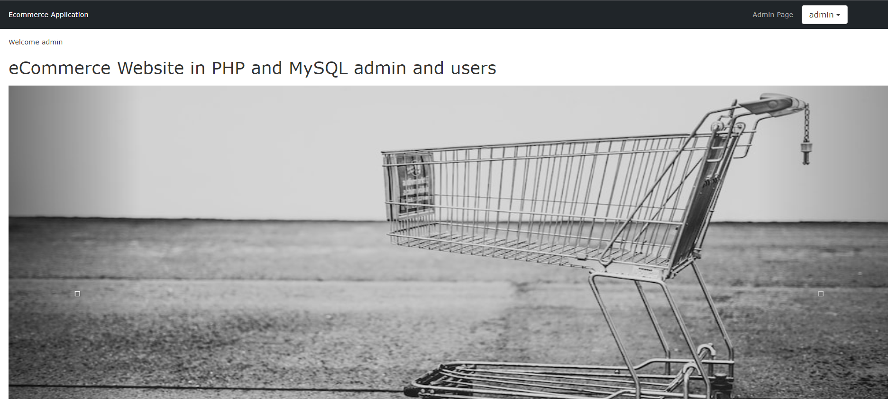

# PHP MySQL Ecommerce Application

A server-rendered ecommerce application with customer and admin workflows, product browsing, authentication, cart management, checkout, and order tracking.



## Features

- Customer registration and login
- Product catalogue with categories and product details
- Cart, checkout, and order history
- Admin product, category, and order management
- Responsive header, mobile navigation, icon-based social footer, and go-to-top control

## Tech stack

PHP, MySQL, HTML, CSS, Sass, JavaScript, jQuery, and Bootstrap.

## Run locally

1. Install PHP 8 or later with the MySQLi and Fileinfo extensions, and install MySQL 8 or later.
2. Import `database/schema.sql` into MySQL. It creates the `admin_panel` database and the tables used by the app.
3. Configure `DB_HOST`, `DB_USER`, `DB_PASSWORD`, and `DB_NAME` in the environment where PHP runs. The local defaults are `localhost`, `root`, an empty password, and `admin_panel`.
4. Make `uploads/` writable by the PHP process so administrators can add product and category images. The directory blocks script execution and image uploads are limited to 5 MB.
5. Start the app from the repository root with `php -S localhost:8000` or serve it through XAMPP/Apache, then open `http://localhost:8000/`.

To create an administrator for a local development database, register a normal account and promote it explicitly in MySQL:

```sql
UPDATE users SET role = 1 WHERE email = 'admin@example.com';
```

Keep database credentials in environment variables. Do not commit production credentials or use the default local credentials on a public server.

GitHub Pages deployment is not used because PHP requires a server runtime.

## Links

- Portfolio: [https://www.ashishranjan.net/](https://www.ashishranjan.net/)
- GitHub: [https://github.com/a2rp](https://github.com/a2rp)
- CodePen: [https://codepen.io/ash1198](https://codepen.io/ash1198)
- LinkedIn: [https://www.linkedin.com/in/aashishranjan](https://www.linkedin.com/in/aashishranjan)
- Facebook: [https://www.facebook.com/theash.ashish/](https://www.facebook.com/theash.ashish/)
- YouTube: [https://www.youtube.com/@ashishranjan-ashz?sub_confirmation=1](https://www.youtube.com/@ashishranjan-ashz?sub_confirmation=1)
- Email: [ash.ranjan09@gmail.com](mailto:ash.ranjan09@gmail.com)

## Support

- Support: [https://a2rp-donation-page.netlify.app/](https://a2rp-donation-page.netlify.app/)
- Buy Me a Coffee: [https://buymeacoffee.com/a2rp](https://buymeacoffee.com/a2rp)
- Patreon: [https://www.patreon.com/a2rp](https://www.patreon.com/a2rp)
